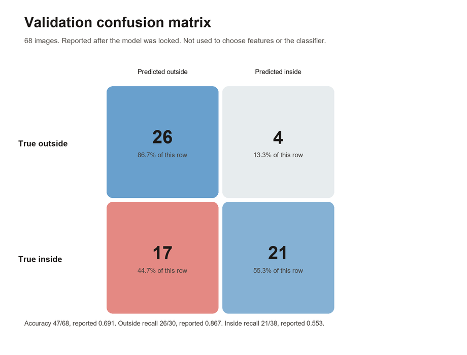
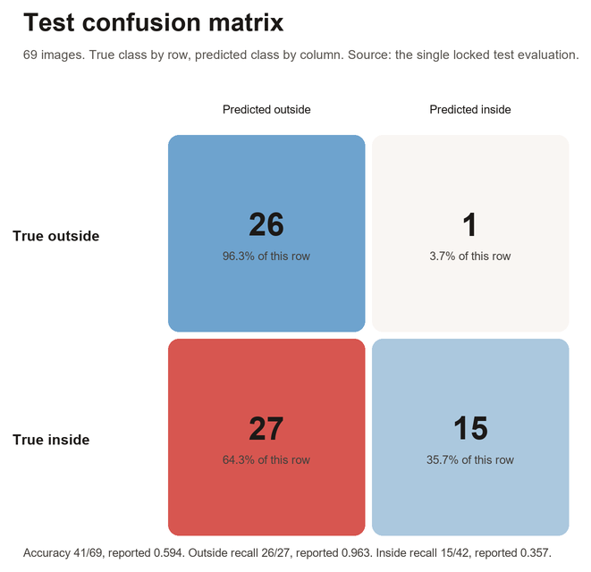
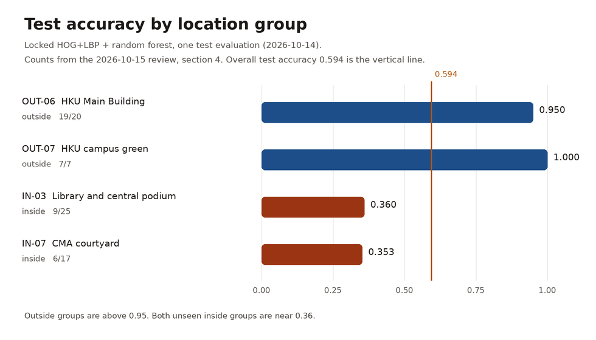

# COMP4423 Assignment 2

## PolyU Main Campus Image Classification

**Name:** Huang Haoran
**Student number:** 24101322D
**Course:** COMP4423 Computer Vision, 2026/27 Semester 1
**Deadline:** 23:59 HKT, 28 October 2026

Dataset link (same string as `DATASET_LINK.txt`): https://drive.google.com/drive/folders/1_ld7gsHLhzyFJY3bUgTIwoOeVXRDFuAr

The complete photograph set is on Google Drive as 27 zip parts named `COMP4423_A2_dataset_part01.zip` through `COMP4423_A2_dataset_part27.zip`. Download all 27 and unpack them into one directory; the file names inside are the ones used in this report. The link is shared as "anyone with the link", so no sign-in is needed.

---

## 1. Introduction

### 1.1 Problem and motivation

The program takes one scene photograph and predicts whether the camera was inside the Hong Kong Polytechnic University main campus. The positive class is that main campus only. A building that belongs to PolyU but sits off the main campus is outside. The label is geographic. It is not “indoors versus outdoors”, and it is not “red brick versus something else”.

The practical question is whether a traditional classifier, reading pixels alone, can tell those two geographies apart when many scenes look alike: walkways, courtyards, lawns, and red-brick façades exist on both sides of the boundary. The Hong Kong University Main Building was collected for that reason. It is red brick, and it is outside PolyU.

### 1.2 Class definitions

The assignment’s definitions are used without a local rewrite.

| Label | Definition used in this project |
|---|---|
| inside (1) | The camera and the main scene are inside the PolyU main campus, using the official campus map as the boundary (`https://www.polyu.edu.hk/campus-map/`). |
| outside (0) | The camera and the main scene are outside that campus. Affiliated sites off the main campus stay outside. |

Uncertain boundary views are excluded: gate thresholds, covered turnstiles at the entrance, connecting bridges, and shots that look across the boundary. The camera and the subject must be on the same side. Labels are not assigned from red brick, a logo, or architectural style. The classifier receives pixels only. GPS, EXIF, file names, folder names, and map lookups may be used to check a label or to find a file. They are not features.

At the main entrance, 11 photographs were removed under this rule: 4 taken at the campus name board, where the side of the gate is ambiguous, and 7 in the covered passage at the turnstiles, which is a threshold and also contains recognizable people.

### 1.3 Pipeline in one pass

1. Photographs are grouped by physical place. One place is one `group_id`.
2. Groups are split into train, validation, and test. A group is never split.
3. Each training and evaluation image is resized and center-cropped to 256×256 by `resize_and_crop` in `src/task3/preprocess.py`.
4. HOG and uniform LBP are computed on the grayscale crop, standardized separately, and concatenated.
5. A random forest (300 trees, maximum depth 12) outputs outside or inside.
6. The fitted object is `models/task3_pipeline.joblib`.

Deep networks and CNN features are not used. Task 3 of the assignment excludes them.

### 1.4 Local application

Section 6 is the desktop program that loads `models/task3_pipeline.joblib` and shows one photograph’s prediction. Sections 4 and 5 are the validation report and the single test evaluation of that same object. The application does not choose features and does not rescore the test set.

---

## 2. Dataset

### 2.1 Places and the collection plan

One physical place is one location group. Nearby views of the same courtyard, building, or landmark stay together. Separate buildings in the same district do not. HKU’s modern teaching blocks and the Main Building are different groups. West Kowloon’s M+ museum, Art Park, and harbourfront promenade are different groups. Continuous PolyU walkways stay in one group.

Inside the group, variation is recorded in columns rather than new groups: `sub_area` for the part of the place, and `scene_class` for one of 13 scene types. The four shooting axes also stay inside the group. Making any one of them its own group would turn the split into a split on that axis.

| Axis | How it was varied |
|---|---|
| Viewpoint | About six stations. Facing direction (front, 45 degrees, side), camera height (ground, slight upward, downward from steps), and horizontal placement of the subject (left, center, right). |
| Distance | Two stations, each with a near, middle, and far frame. |
| Close view | Wall–ground junctions and materials, with spatial depth kept in the frame. Isolated objects were not collected. |
| Lighting | Night frames kept in the daytime group of the same place, so day and night of one place cannot fall into different splits. |
| Background | At least three background kinds per group. The same kind is used on both sides of the label when possible. |

Quotas in the collection note are within-group targets, not the final counts. Final counts are below.

Both classes contain buildings, covered walkways, green space, and open paving. Eleven of the thirteen scene types appear on both sides of the label. The two types that appear only outside are deliberate: five indoor HKU corridor frames, so that “indoors” cannot become a synonym for inside, and nine market-stall frames from Temple Street, which have no campus counterpart.

Among the 718 usable photographs, before the per-group cap:

| Scene type | inside | outside |
|---|---:|---:|
| Building façade | 63 | 79 |
| Covered walkway | 73 | 63 |
| Urban distance view | 24 | 54 |
| Tree-lined path | 26 | 48 |
| Green space | 15 | 35 |
| Ramp or steps | 34 | 18 |
| Building entrance | 28 | 9 |
| Construction hoarding | 14 | 5 |
| Paved plaza | 14 | 16 |
| Road frontage | 10 | 57 |
| Water | 5 | 14 |
| Indoor space | 0 | 5 |
| Market stall | 0 | 9 |

Row sums equal 718. Façades and covered walkways are the two largest types (142 and 136). Water has 19 photographs. Road frontage is unbalanced (10 inside, 57 outside). Construction hoarding is temporary (14 inside, 5 outside). These limits are discussed in Section 2.6.

Night frames are 31/306 = 10.1% of usable inside images and 56/412 = 13.6% of usable outside images. The rates are close, so brightness alone is a weak class cue. All 31 campus night frames stay in the daytime group of the same place (IN-01, IN-02, IN-04, or IN-05).

Figure 1 (`docs/figures/figure1_inside_locations_annotated.png`) marks the seven inside places on a PolyU campus map. The counts printed on that figure sum to 306, which is the usable inside total before the cap. Marker 05 was placed on the south side of J Core, and its legend is the inner lawn and clock tower at the main entrance. The gate threshold itself is in the excluded set, not in IN-05.

### 2.2 Hard negatives

Red is the easiest shortcut. Much of the main campus is red brick, and a color histogram can score well by voting “red means inside”. Outside photographs were chosen to block specific inside appearances:

| Outside group | Inside appearance it matches |
|---|---|
| OUT-06 HKU Main Building (test) | Red-brick façades at IN-01, IN-03, and IN-04. Edwardian red brick and granite. Paired with IN-03, which is also in the test set. |
| OUT-02 HKU modern blocks and links (train) | Coffered walkway IN-02 and covered links IN-06. Includes the five indoor corridors. |
| OUT-09 West Kowloon harbourfront (val) | Entrance steps IN-05 and the large stair at IN-06. |
| OUT-08 Art Park (train) | Open lawns and courts at IN-02, IN-06, and IN-07. Bound to the same split as OUT-05 because the two sites see each other across a road. |
| OUT-05 M+ (train) | Modern buildings and hard plazas. |
| OUT-04 Elements (train) | Large roofs over open space, compared with the coffered ceiling at IN-02. |
| OUT-03 Kowloon Park (train) | Lawns, courtyards, and water. Eleven red-tile Chinese-garden frames are an extra red-brick negative. |
| OUT-07 HKU campus green (test) | Lawns at IN-05 and the courtyard green at IN-07. Not a red-brick negative. Paired with IN-07 in the test set. |
| OUT-01 Jordan (train) | Dense street façades, as a contrast to campus blocks. |

### 2.3 Labels, exclusions, and anchors

734 photographs were annotated. 16 were excluded. 718 remained, in 16 places (7 inside, 9 outside). After a cap of 50 images per group and class balancing, the modeling set has 540 images, 270 inside and 270 outside.

| Excluded | Count | Reason |
|---|---:|---|
| IN-05 | 11 | Name board at the gate (4) or covered turnstile passage (7). Notes on the manifest rows match this split. |
| OUT-01 | 2 | A full license plate in the foreground. `OUT-01_020_IMG_0816` reads `WX 9304` on the photograph (checked 2026-10-15). `OUT-01_052_IMG_1003` is recorded in the manifest notes as `VA 7003`; that frame was not re-read in the same pass. |
| OUT-02 | 2 | Street signs on the outer side of the campus boundary. |
| OUT-03 | 1 | Several recognizable faces. |

Another 22 frames had been queued for a plate or face check. Each was looked at and returned to the usable set. That decision was not taken from a model score.

Phone transfer stripped EXIF GPS. Ground truth anchors are signs that are visible in the frame, including the university library sign and crest (IN-03 `IMG_1459`), Stanley Ho Building (IN-04 `IMG_1229`), CMA Building and Lui Che Woo Building (IN-07 `IMG_1428`), “THE UNIVERSITY OF HONG KONG” on the Main Building (OUT-06 `IMG_0863`), and Jordan Road (OUT-01 `IMG_1002`). The full anchor list is in `progress/task1_dataset_overview.md` §6.2. The campus name board `IMG_1304` is excluded and is not used as an anchor.

### 2.4 Why this scale is enough, and where it is not

There is no required image count. The unit that has to be learned and tested is the place, not the frame. Sixteen places are enough to put several places of each class in training, hold out paired places for a five-fold location check, and still leave a validation pair and a test pair. Adding more frames inside a place that is already in training does not add an unseen place.

The cap and the balance step exist so that one large place cannot dominate the pixel count. OUT-01 entered with 82 usable frames and is stored as 50. The smallest place, OUT-07, has only 7 frames. That group is why the split cannot sit on 60/20/20, as the next section shows. Sixteen places are enough to run the protocol. They are not enough to make the test estimate sharp: the test set can hold only four places.

### 2.5 Split, leakage controls, and counts

`data/annotations/splits.csv` is the split. It was not redrawn for this report. `src/tools/build_dataset.py` refuses to finish if a group crosses splits, if OUT-05 and OUT-08 are separated, or if any split is missing a class. Augmentation is horizontal flip, applied only to training images after the split. Subsampling inside a capped group is evenly spaced so the viewpoint range remains.

Image counts and groups, from `data/annotations/dataset_summary.md`:

| Split | Class | Images | Groups | Group ids |
|---|---|---:|---:|---|
| train | outside | 213 | 6 | OUT-01, OUT-02, OUT-03, OUT-04, OUT-05, OUT-08 |
| train | inside | 190 | 4 | IN-01, IN-02, IN-04, IN-06 |
| val | outside | 30 | 1 | OUT-09 |
| val | inside | 38 | 1 | IN-05 |
| test | outside | 27 | 2 | OUT-06, OUT-07 |
| test | inside | 42 | 2 | IN-03, IN-07 |

Totals: train 403, validation 68, test 69, sum 540. By images that is 403/540, 68/540, and 69/540 (about 74.6%, 12.6%, and 12.8%). By groups it is 10/16, 2/16, and 4/16, which is 62.5%, 12.5%, and 25%. The assignment asks for a split of location groups aiming at 60/20/20, with both classes in every split. Both classes are present in every split. The group shares are the ones to read. OUT-07 has 7 images and cannot fill a 20% outside test group by itself; the test outside side is OUT-06 plus OUT-07, and the validation outside side is the single group OUT-09.

Stored counts per place (original usable → kept):

| Group | Place | Class | Usable | Kept | Split |
|---|---|---|---:|---:|---|
| IN-01 | Walkway, J Core to VA | inside | 71 | 50 | train |
| IN-02 | P/Q coffered walkway | inside | 62 | 50 | train |
| IN-03 | University Library and central podium | inside | 25 | 25 | test |
| IN-04 | FSCH / VS / pool | inside | 53 | 50 | train |
| IN-05 | Main entrance, inner lawn and clock tower | inside | 38 | 38 | val |
| IN-06 | Block court and Core A entrance | inside | 40 | 40 | train |
| IN-07 | CMA Building courtyard | inside | 17 | 17 | test |
| OUT-01 | Jordan | outside | 82 | 50 | train |
| OUT-02 | HKU modern blocks and links | outside | 57 | 50 | train |
| OUT-03 | Kowloon Park | outside | 72 | 32 | train |
| OUT-04 | Elements | outside | 62 | 30 | train |
| OUT-05 | West Kowloon, M+ | outside | 21 | 21 | train |
| OUT-06 | HKU Main Building | outside | 20 | 20 | test |
| OUT-07 | HKU campus green | outside | 7 | 7 | test |
| OUT-08 | West Kowloon, Art Park | outside | 38 | 30 | train |
| OUT-09 | West Kowloon harbourfront | outside | 53 | 30 | val |

Place names in this table follow `progress/task1_dataset_overview.md` §3.1. The generated summary uses shorter labels for a few outside rows; the group id, class, counts, and split are the summary’s.

### 2.6 Dataset limits that affect later numbers

- The test estimate rests on four places. A single difficult building moves the accuracy.
- OUT-07 contributes only 7 test images.
- Road frontage is 10 inside versus 57 outside in the usable pool. A model could treat heavy traffic as outside. The four test places are a library, a courtyard, a brick building, and a lawn, so Section 5 does not attribute the test misses to that imbalance.
- Indoor evidence exists only on the outside class, and only as 5 frames.
- Construction hoarding will disappear. It is a durability limit, not a stable campus cue.
- Night shares (10.1% and 13.6% of the usable pool) sit a little above a 5–8% target. They are similar across classes.
- IN-01 (train) and IN-05 (val) both include views around the Innovation Tower and VA. Validation accuracy is expected to look stronger than a fully unseen place. Model choice does not use it.

---

## 3. Method

### 3.1 Design

The comparison was fixed before the run and is written in `progress/task3_experiment.md` §§1–7.

Stage A asks which representation helps. Six hand-crafted features share one classifier: standardization, where the classifier needs it, and a linear SVM with `C = 1`. Stage B asks whether the classifier matters. The two features with the highest location-holdout score are each trained with the classifiers in Section 3.4. Parameters are fixed. There is no search on the validation set and none on the test set.

The selection score of a configuration is the mean balanced accuracy of five location-holdout folds. Balanced accuracy is the average of the outside recall and the inside recall, so a fold that only recognizes one class does not look successful. Validation accuracy is written down and is not part of the sort. The review of 2026-10-15 checked that the sort key in `src/task3/cv.py` is that mean balanced accuracy.

Ties on features keep the smaller dimension, then the earlier id. Ties on classifiers keep the simpler one in this order: logistic regression, linear SVM, multinomial naïve Bayes, k-NN, random forest, histogram gradient boosting. If the winner had been a linear SVM, one extra row would have reduced that feature to 100 principal components, fit on the training fold only, and trained an RBF SVM. The winner was not a linear SVM, so that row was not added.

### 3.2 Preprocessing

`resize_and_crop` is the only resizer.

1. Open the file as RGB with Pillow. OpenCV’s BGR reader is not used, so a later interface cannot silently disagree with evaluation.
2. Scale the short side to 256 with area interpolation, keeping the aspect ratio.
3. Center-crop to 256×256. A landscape frame loses equal strips on the left and right. A portrait frame loses equal strips on the top and bottom.
4. Return `uint8` of shape 256×256×3. HOG, LBP, and SIFT convert that crop to gray. The color histogram uses HSV of the same crop.

Horizontal flip is a training augmentation only. Validation and test images are not flipped. Color jitter is not used. Night and lighting were collected on purpose; jitter would hide that axis.

The random seed is 42.

### 3.3 Features

| Id | Feature | Setting | Dimension |
|---|---|---|---:|
| F1 | HSV histogram | H 16 × S 16 × V 8. Whole frame plus a 2×2 grid. Each histogram L1-normalized, then concatenated. | 10240 |
| F2 | HOG | 9 orientations, 16×16 cells, 2×2 blocks, L2-Hys, on gray. | 8100 |
| F3 | LBP | Uniform pattern, P = 8, R = 1, 10 bins. Whole frame plus 2×2, each block L1-normalized. | 50 |
| F4 | HOG + LBP | F2 and F3 standardized separately on the training images, then concatenated. | 8150 |
| F5 | Bag of words | SIFT, at most 500 keypoints. Mini-batch k-means, 256 words, fit on that fold’s training descriptors only. Word counts L1-normalized. An image with no keypoints becomes a zero histogram and is counted in the log. | 256 |
| F6 | Bag of words + spatial pyramid | F5 on the whole frame, plus four histograms on a 2×2 grid. | 1280 |

SIFT is `cv2.SIFT_create` from `opencv-contrib`. If that function is missing, the run stops. ORB is not a substitute. In the environment used for the 2026-10-14 run, SIFT was available.

The vocabulary is not stored across folds. A fold that is building a codebook never sees the held-out place.

### 3.4 Classifiers

| Id | Classifier | Setting |
|---|---|---|
| C1 | Linear SVM | `LinearSVC`, `C = 1`, standardized features |
| C2 | Logistic regression | `C = 1`, `lbfgs`, standardized features |
| C3 | k-NN | k = 5. Cosine distance on histogram features. Euclidean distance when the feature includes HOG. |
| C4 | Random forest | 300 trees, `max_depth = 12`, `random_state = 42` |
| C5 | Histogram gradient boosting | `max_depth = 6`, `random_state = 42` |
| C6 | Multinomial naïve Bayes | `alpha = 1`, only for non-negative L1 histograms (F1, F3, F5, F6) |

C1, C4, and C5 are the three families named in the assignment (SVM, random forest, gradient boosting). C2 and C3 are different decision rules. C6 is a simple histogram control. F2 and F4 skip C6 because they are not non-negative histograms.

### 3.5 Location holdout

Each training place is a single class, so a fold always holds out one inside place and one outside place together. OUT-05 and OUT-08 are one atom. The five folds are written in `src/task3/config.py`:

| Fold | Held-out inside | Held-out outside |
|---|---|---|
| 0 | IN-01 | OUT-01 |
| 1 | IN-02 | OUT-02 |
| 2 | IN-04 | OUT-03 |
| 3 | IN-06 | OUT-04 |
| 4 | IN-01 | OUT-05 and OUT-08 |

IN-01 is held out twice because there are five outside atoms and four inside training groups. The five balanced accuracies are averaged as they are. The two IN-01 folds are not merged.

On each fold the feature model (codebook, standardization, and PCA if any) is fit on the other training images, including their horizontal flips. Flips are not placed in the held-out set. The held-out places are scored with balanced accuracy and with both recalls.

### 3.6 Locked pipeline and how to rerun it

After Stage B, the winning pair is refit on all training images plus horizontal flips. It is saved with joblib. Validation is scored once for the report. The test set is scored once. Per-image test predictions were written to `outputs/task3/test_predictions.csv` on the machine that trained the model. That directory is gitignored; the numbers used here are the ones copied into the experiment note.

Commands, from the repository root, with the environment recorded in the experiment note (`D:\Program Files\learn_torch\venv`, Python 3.12):

```
python -m src.task3.run_stage_a
python -m src.task3.run_stage_b
python -m src.task3.evaluate
```

Pinned packages in `requirements.txt`:

```
numpy==2.4.3
Pillow==12.1.1
opencv-contrib-python==5.0.0.93
scikit-image==0.26.0
scikit-learn==1.8.0
joblib==1.5.3
```

`opencv-contrib-python` is required. The non-contrib wheel has no SIFT, and the feature module exits rather than switching descriptors.

The crop cache key includes the image size (`s256__filename`). `run_stage_a` and `run_stage_b` hash `splits.csv` and `src/task3/*.py` before reusing a results table. A mismatch stops the run unless `--force` is passed. The 2026-10-15 change to that key was not followed by a new training run. The tables in Section 4 are the 2026-10-14 run.

Code layout: `src/task3/config.py`, `data.py`, `preprocess.py`, `features.py`, `models.py`, `cv.py`, `run_stage_a.py`, `run_stage_b.py`, `evaluate.py`. Dataset construction is `src/tools/build_dataset.py`. File names are resolved only in `data.py`, to find a path. `transform` receives arrays. The local window is `src/task5/app.py` and `src/task5/predict.py` (Section 6). It loads the saved pipeline and does not fit a new one.

---

## 4. Experimental results

Selection uses location-holdout balanced accuracy only. The validation column is display. Figures in this section are copied from `progress/task3_experiment.md` §8.

### 4.1 Stage A: linear SVM, six features

| Feature | Location-holdout BA | Inside recall | Outside recall | Validation accuracy |
|---|---:|---:|---:|---:|
| F4 HOG+LBP | 0.721 | 0.698 | 0.744 | 0.779 |
| F2 HOG | 0.708 | 0.677 | 0.740 | 0.750 |
| F3 LBP | 0.588 | 0.536 | 0.641 | 0.779 |
| F5 bag of words | 0.566 | 0.453 | 0.679 | 0.824 |
| F6 bag of words + pyramid | 0.563 | 0.414 | 0.712 | 0.809 |
| F1 color histogram | 0.538 | 0.495 | 0.581 | 0.544 |

F4 and F2 enter Stage B.

The color histogram is last. That matches the reason HKU was collected: red brick is on both sides of the label, and color does not survive a change of place. Bag-of-words has the highest validation accuracies (0.824 and 0.809) and location-holdout scores near 0.56. The validation pair is the entrance lawn against the West Kowloon harbourfront, which is visually easy, and a codebook can memorize keypoints of buildings it has seen. Validation accuracy is the wrong column to maximize. It is shown so that this disagreement stays visible.

### 4.2 Stage B: F4 and F2 across classifiers

C6 does not apply to F2 or F4. The winner is not a linear SVM, so the RBF row was not run.

| Feature | Classifier | Location-holdout BA | Inside recall | Outside recall | Validation accuracy |
|---|---|---:|---:|---:|---:|
| F4 | C4 random forest | **0.757** | 0.660 | 0.855 | 0.691 |
| F2 | C4 random forest | 0.748 | 0.649 | 0.846 | 0.676 |
| F2 | C3 k-NN | 0.740 | 0.562 | 0.918 | 0.691 |
| F4 | C3 k-NN | 0.739 | 0.556 | 0.922 | 0.706 |
| F2 | C2 logistic regression | 0.725 | 0.685 | 0.765 | 0.735 |
| F4 | C2 logistic regression | 0.722 | 0.701 | 0.744 | 0.765 |
| F4 | C5 histogram gradient boosting | 0.721 | 0.648 | 0.793 | 0.603 |
| F4 | C1 linear SVM | 0.721 | 0.698 | 0.744 | 0.779 |
| F2 | C1 linear SVM | 0.708 | 0.677 | 0.740 | 0.750 |
| F2 | C5 histogram gradient boosting | 0.701 | 0.626 | 0.775 | 0.676 |

The locked pipeline is **F4 HOG+LBP + C4 random forest**.

On the same F4 features, the linear SVM’s validation accuracy is 0.779 and the forest’s is 0.691. The forest is still the one selected, because its location-holdout balanced accuracy is higher (0.757 against 0.721). k-NN’s outside recall is higher (0.922 on F4) and its inside recall is 0.556. On fold 2, which holds out IN-04 and OUT-03, k-NN labels almost all of the held-out campus as outside. The forest’s balanced accuracy on that fold is 0.616, the highest of the five F4 classifiers. The 2026-10-15 review confirmed `ba_2 = 0.61625` in `stage_b.csv`.

F4 logistic regression has a higher holdout inside recall than the forest (0.701 against 0.660) and a lower balanced accuracy (0.722 against 0.757). The written score is balanced accuracy. The test set’s later inside recall does not reopen that choice.

F4 gradient boosting and F4 linear SVM both print as 0.721. The 2026-10-15 review checked the unrounded means in `stage_b.csv` and found the pair 0.72060 and 0.72089, which both print as 0.721. The review treated the displayed order as a tie caused by rounding. It does not change the winner. The review does not assign those two unrounded values to a classifier in the text used here, so this report does not either.

The representation moves the score more than the classifier does. From color to HOG+LBP under the same linear SVM, location-holdout balanced accuracy goes from 0.538 to 0.721. On F4, the five classifiers span about 0.721 to 0.757.

### 4.3 Validation after the refit

The forest was refit on the full training split, with horizontal flips, and then applied to the 68 validation images (IN-05 38, OUT-09 30).

Accuracy **0.691**. Balanced accuracy **0.710**.

|  | Predicted outside | Predicted inside |
|---|---:|---:|
| True outside | 26 | 4 |
| True inside | 17 | 21 |

| Class | Precision | Recall | F1 | Support |
|---|---:|---:|---:|---:|
| outside | 0.605 | 0.867 | 0.712 | 30 |
| inside | 0.840 | 0.553 | 0.667 | 38 |

These three-decimal figures are the published rounding of the matrix: 47/68 = 0.691, outside recall 26/30 rounds to 0.867, inside recall 21/38 rounds to 0.553. Seventeen campus frames are called outside, and four harbourfront frames are called inside. Inside recall is already 0.553 on this easier pair. Section 2.6 is why 0.691 is not quoted below as generalization.



*Figure 2. Validation confusion matrix of the locked pipeline. Counts from the experiment note, Section 8.3. Not used to choose the model.*

### 4.4 Test, one evaluation

69 images: IN-03 25, IN-07 17, OUT-06 20, OUT-07 7.

Accuracy **0.594**. Balanced accuracy **0.660**.

|  | Predicted outside | Predicted inside |
|---|---:|---:|
| True outside | 26 | 1 |
| True inside | 27 | 15 |

| Class | Precision | Recall | F1 | Support |
|---|---:|---:|---:|---:|
| outside | 0.491 | 0.963 | 0.650 | 27 |
| inside | 0.938 | 0.357 | 0.517 | 42 |

Working from the same cells: accuracy 41/69 rounds to 0.594; outside precision 26/53 rounds to 0.491; outside recall 26/27 rounds to 0.963; outside F1 is 0.650; inside precision 15/16 rounds to 0.938; inside recall 15/42 rounds to 0.357; inside F1 rounds to 0.517; balanced accuracy rounds to 0.660. The 2026-10-15 review recomputed the same matrix from the prediction CSV (outside 0.4906 / 0.9630 / 0.6500, inside 0.9375 / 0.3571 / 0.5172).



*Figure 3. Test confusion matrix. Same locked pipeline, evaluated once.*

A classifier that always says outside scores 27/69 = 0.391 accuracy and 0.5 balanced accuracy on this test set. The locked model scores 0.594. The gain is 14 images: 15 correct inside predictions, minus the 1 outside image predicted inside. Of 69 predictions, 53 are outside. When the model does say inside, it is usually right (15 of 16). The error is missed campus scenes, not a flood of false campus predictions.

---

## 5. Error analysis

The full working note is `progress/task4_evaluation.md`. This section is what goes in the report.

### 5.1 How to read the test matrix

The four cells are not one story.

- 26 of 27 outside images are correct.
- 1 outside image is called inside. That is the only false inside in the test set.
- 27 of 42 inside images are called outside. This cell is the failure.
- 15 inside images are correct.

Outside precision is 0.491 because 27 campus misses sit in the same predicted-outside column as the 26 true outside images. Inside precision is 0.938 because the inside column is almost clean. Accuracy 0.594 hides that split. Balanced accuracy 0.660 still sits far below the location-holdout score of the same configuration (0.757), which was measured on other places and on other training subsets.

### 5.2 Failure by place

The 2026-10-15 review split the test predictions by group. Each group has one label, so a group’s errors can land in only one off-diagonal cell.

| Group | Correct / n | Accuracy | Where the errors go |
|---|---|---:|---|
| OUT-06 HKU Main Building | 19/20 | 0.950 | 1 image predicted inside. This is the only false inside in the matrix. |
| OUT-07 HKU campus green | 7/7 | 1.000 | None. |
| IN-03 Library and central podium | 9/25 | 0.360 | 16 images predicted outside. |
| IN-07 CMA courtyard | 6/17 | 0.353 | 11 images predicted outside. |

Check: 19+7+9+6 = 41, the numerator of 41/69. The 16 and 11 misses sum to the 27 false outsides. The single OUT-06 miss is the single false inside. OUT-07 cannot contain that false inside.



*Figure 4. Test accuracy of the four held-out places. The vertical line is the overall test accuracy 0.594.*

The pattern is stable across the two unseen campus places, and it is stable across the two unseen outside places in the opposite direction:

1. Unseen campus places are mostly predicted outside (0.360 and 0.353).
2. Unseen outside places are almost all predicted outside (0.950 and 1.000).
3. The red-brick hard negative works. HKU Main Building is not accepted as PolyU.
4. The library, which is also red brick and was paired with OUT-06 for that reason, is mostly predicted outside as well (16 of 25). The model does not vote “red brick means inside”. It pushes both brick sites toward outside, and the campus site is the one that suffers.
5. Green space does not transfer either. OUT-07 is 7/7 outside. IN-07, the courtyard collected as the visual partner, is 6/17.

On the final refit, inside recall is 0.553 on validation and 0.357 on test. During selection, the same feature and forest had a mean inside recall of 0.660 across the five training-location folds. Those three numbers use different fits. They are not epochs of one curve. They do show the same direction: campus scenes that were not in the fit are the ones dropped.

The review’s description matches these counts. On the unseen campus places the model behaves like an approximate constant predictor toward outside. It is approximate because 15 campus images are still recovered. Calling it a literal constant would erase that cell.

### 5.3 Relation to HOG and LBP

F4 is 8100 HOG dimensions plus 50 LBP dimensions (`src/task3/config.py`). Under a linear SVM, adding LBP moves location-holdout balanced accuracy from 0.708 to 0.721. Under the forest, it moves from 0.748 to 0.757. The texture block is a small add-on. The test failure belongs to this local gradient representation, with LBP not supplying the missing cue.

HOG counts edge orientation inside 16×16 cells. It does not encode which building this is, or which side of the campus boundary the camera stands on. Uniform LBP at radius 1 is a local texture histogram. Color is discarded. Most of the building’s layout is discarded. After concatenation, a forest of depth 12 can split training places whose edge patterns it has seen. The training campus places are the J–VA walkway, the P/Q coffered walkway, FSCH / the pool, and the Core A court. The test campus places are the library podium and the CMA courtyard. Those edge statistics do not have to match.

Two representations that might seem more semantic were measured on the location holdout and were worse:

- Color is the cue most tempted by red brick. It scored 0.538, last in Stage A. It was not evaluated again on the test set, and this report does not invent that number. The test behavior of the locked model is still informative: OUT-06 is rejected (19/20) while IN-03 is also mostly rejected (16 of 25 predicted outside). Removing color removed an unreliable shortcut. It did not leave a feature that can say “this brick building is the library”.
- Bag-of-words looked best on validation and failed the change of place (0.566 and 0.563). A codebook of training keypoints is a memory of training buildings. That is why it lost the selection, and why a high validation number was not allowed to overrule the holdout.

The training counts, 213 outside and 190 inside, are too close to explain 53 outside predictions out of 69. The bias shows up in the recalls of the selected forest itself (holdout means 0.855 outside and 0.660 inside) and becomes sharp on the four test places. The mechanism consistent with the feature definition is that a new campus layout falls into regions of the HOG space that the forest already associates with outside scenes.

The assignment asks about background bias, lighting, similar places, and viewpoint.

| Asked failure | What is measured here |
|---|---|
| Similar-looking places | Measured. OUT-06 against IN-03 (brick), OUT-07 against IN-07 (green / court). Outside is recognized. Inside is about one third correct. |
| Background bias | The scene table was built so that 11 of 13 types exist in both classes. Test errors cluster by place. That does not support a story in which one background type produces all 27 misses. |
| Lighting | Night shares on the 718 usable images are 10.1% inside and 13.6% outside. No color jitter was applied. The test CSV is not in this workspace, so night frames were not joined to predictions. A night-error rate is not reported. |
| Viewpoint | Viewpoints vary inside each place by design. The error table has no viewpoint column. A viewpoint-error rate is not reported. |
| Road-frontage imbalance | 10 inside versus 57 outside in the usable pool. The test places are not that road set. The misses are not attributed to traffic. |

This is the ceiling of HOG+LBP on a place it has not seen, under a protocol that refuses to train on that place. It is the result Task 4 asks for. It is not an unfinished grid search.

### 5.4 Qualitative examples

Figures 2–4 are the quantitative figures. Figure 1 is the collection map. Figure 5 is the contact sheet of individual test predictions, and it is now in the draft.

The sheet was produced by `docs/figures/plot_task4_locked.py` from `outputs/task3/test_predictions.csv` and the photographs in `data/pictures/`. The script refuses to draw unless the prediction table still sums to 26, 1, 27, 15 and the four place rates still equal 19/20, 7/7, 9/25 and 6/17, so a figure can only ever be drawn from the locked predictions. `docs/figures/task4_example_manifest.csv` records which file sits in which cell.

The thirteen frames were chosen by a rule fixed in advance, not by how they look: within each cell, in filename order — 2 correct OUT-06, 2 correct OUT-07, the single false inside (necessarily OUT-06), 2 missed IN-03, 2 missed IN-07, 2 correct IN-03, and 2 correct IN-07. A frame was never picked because it appeared to support the conclusion.

The grid shows the two failure modes at once. The one false inside is `OUT-06_012_IMG_0892.jpg`, a glass entrance and a flight of steps at HKU, not the red-brick facade that dominates its group — the 10 OUT-06 facade frames are all correct. The missed inside frames are `IN-03_001_IMG_1444.jpg` and `IN-03_002_IMG_1445.jpg`, a brick rib wall filling the frame, and `IN-07_005_IMG_1431.jpg` and `IN-07_006_IMG_1432.jpg`, the CMA courtyard pulled back to include trees and seating. Against those, `IN-07_001_IMG_1427.jpg` and `IN-07_002_IMG_1428.jpg` are the same courtyard framed close on its patterned wall and doorway, and both are correct. The viewpoint, not the building, separates them.

The Chinese working record `progress/task4_evaluation.md` §5.1 carries the same eight frames with a scene-by-scene description of each one; the English captions here are deliberately terse so that the figure and the record cannot drift apart.

### 5.5 The test numbers do not retune the model

Accuracy 0.594 and inside recall 0.357 are the score of the pipeline that was locked on location-holdout balanced accuracy. IN-03 and IN-07 stay in the test set. Features are not re-ranked on these 69 images. The forest is not swapped for logistic regression because logistic regression had a higher holdout inside recall. A later check of whether more campus places would change the picture needs new places and a new held-out evaluation of this same pipeline. It does not move the current test groups into training.

---

## 6. Application (Task 5)

The local program lets a user select one scene photograph, shows that photograph, and returns either “Inside PolyU main campus” or “Outside PolyU main campus”. It is a desktop window written with Tk from the Python standard library. Nothing was added to `requirements.txt`. Pillow, joblib, OpenCV, and scikit-learn are the Task 3 dependencies. The design and the checks in Section 6.4 are recorded in `progress/task5_app.md`. The same launch lines are in the root `README.md`.

The program does not train and does not edit `splits.csv`. The classifier remains the locked HOG+LBP random forest in `models/task3_pipeline.joblib`. The test accuracy 0.594 and the other Section 4–5 figures are unchanged.

### 6.1 How to launch

From the repository root, in the same environment as Task 3:

```
python -m src.task5.app
```

That opens the window. With no display, the same loader and the same preprocessing print one image and do not open a window:

```
python -m src.task5.app --image path\to\photo.jpg
```

The command prints the English label and, for this forest, the outside and inside probabilities. If the file cannot be read, it prints the error and exits with status 1.

On Windows, `pythonw -m src.task5.app` opens the window without a console. The official Windows installer includes Tk. If Ubuntu reports that `_tkinter` is missing, install `python3-tk`. If `models/task3_pipeline.joblib` is absent, the window tells the user to run `python -m src.task3.evaluate` and does not run that training step itself. In this submission the saved file is already present.

### 6.2 What the window shows

The window title is “PolyU Main Campus Classifier”.

1. **Select image…** opens a file dialog. Ctrl+O does the same. The dialog accepts jpg, jpeg, png, bmp, tif, tiff, and webp.
2. The left pane shows the selected photograph and its original width and height. The file name is written next to the button so the user can see which file is open. That string is not given to the classifier.
3. The right pane prints the sentence stored on the pipeline as `display_`: “Inside PolyU main campus” or “Outside PolyU main campus”.
4. This random forest implements `predict_proba`, so the window also draws the inside probability and the outside probability.
5. The thumbnail is the array returned by `resize_and_crop`: the 256×256 center crop that the model receives. The widget scales that crop for display. The array passed to `predict` stays 256×256×3.

A line at the bottom of the window names `models/task3_pipeline.joblib` and states that the file name, folder, EXIF, and GPS are not used.

### 6.3 How prediction is called

`src/task5/predict.py` is the prediction path. `src/task5/app.py` is the window and the `--image` printer. The order matches `src/task3/evaluate.py`: crop, then predict.

1. `load_rgb` in `src/task3/preprocess.py` reads the file as RGB `uint8`. It does not rotate from EXIF. Training and evaluation did not rotate, so the application does not add a rotation the model never saw.
2. `resize_and_crop` in the same module scales the short side to 256 and center-crops to 256×256×3. There is no second resizer.
3. `pipeline.predict([cropped])` returns 0 for outside or 1 for inside. The argument is a one-image list. A bare array would be iterated by rows.
4. `pipeline.predict_proba([cropped])` fills the two probabilities. If a future estimator had no `predict_proba`, the window would say so and would still show the label. This forest has the method.
5. `pipeline.display_[label_id]` is the English sentence written when the pipeline was saved: `{0: "Outside PolyU main campus", 1: "Inside PolyU main campus"}`.

`joblib.load` returns a scikit-learn `Pipeline` with two steps. `features` is `ImageFeatures(feature_id="F4")`, which is `HogLbp`. `clf` is `RandomForestClassifier` with 300 trees, `max_depth=12`, and `random_state=42`. `classes_` is `[0, 1]`.

`HogLbp.transform` calls `resize_and_crop` again. When the image is already 256×256, that function returns the same array. The call written in the application is still `src.task3.preprocess.resize_and_crop`.

`predict_rgb` accepts an RGB array. The path is used only to read those pixels and to label the button row with the file name.

### 6.4 Checks recorded for the application

`progress/task5_app.md` §4 records these checks on the installed `requirements.txt`. They do not refit the forest and they do not replace Section 4 or Section 5.

- From open to label, one image takes about 0.1 seconds, including HOG+LBP, `predict`, and `predict_proba`.
- Every crop is `(256, 256, 3)`. Calling `resize_and_crop` again on that crop leaves the array unchanged. Predicting the uncropped original returns the same label as cropping first.
- The same pixels saved as `IN-99_inside_campus.jpg` and as `OUT-99_outside_campus.jpg` produce the same label and the same probabilities. The name in the window changes. The sentence does not.
- An unreadable text file opens an error dialog and keeps the previous label. The command-line form exits with status 1.
- Noise, a 1×1 image, a very wide image, all black, all white, a grayscale JPEG, a PNG with an alpha channel, and a 3840×2400 JPEG each returned one of the two English sentences.
- The window opened at about 880×585. After a file was chosen, the canvas showed the original, the thumbnail showed the crop, and the prediction text was one of the two sentences. `python -m src.task5.app --image <file>` and `python src/task5/app.py --image <file>` printed that same label and both probabilities.

`data/pictures/` was not in that checkout, so the 69-image test split was not replayed through the window. The example figure on page 2 of the assignment PDF was cut at the midline only to confirm that the program returns a label and does not crash. Those two halves are not the test set, and they were not used to change the model.

| Half of the assignment example figure | Pixels | Program output | outside | inside |
|---|---|---|---:|---:|
| Left: courtyard, captioned inside on the figure | 960×1080 | Outside PolyU main campus | 0.512 | 0.488 |
| Right: street, captioned outside on the figure | 960×1080 | Inside PolyU main campus | 0.460 | 0.540 |

Both probability pairs sit near one half. That is this locked pipeline on two scenes it was not trained on. It is not a new test accuracy. The held-out test result remains accuracy 0.594, inside recall 0.357, and the four place rates in Section 5.

---

## 7. Required template questions

The report template asks the following six questions. The answers use the dataset notes, the experiment note, and the corrections recorded on 2026-10-15.

### How do you design and test the program?

The geographic rules came first: main campus versus not, boundary frames dropped, one physical place as the split unit. Collection then filled both classes with matched scene types and with outside places that look like campus, especially HKU brick.

The learning program was designed as two locked stages rather than a search over every feature–classifier pair. Stage A compares six pixel features with one linear SVM. Stage B compares classifiers on the two winning features. The score is the mean balanced accuracy of five pre-written location-holdout folds. Validation accuracy is printed and ignored by the sort. The test set is applied once, after the pipeline is refit on all training images and saved.

Testing of the data side is the check inside `build_dataset.py`: no group crosses a split, the two mutually visible West Kowloon groups stay together, and every split contains both classes. Testing of the numbers is the 2026-10-15 review, which matched the published tables to the result CSV files and recomputed the test confusion matrix from the per-image predictions. The commands and package pins are in Section 3.6.

The desktop program is tested apart from that selection. `progress/task5_app.md` records that one array saved under `IN-99_inside_campus.jpg` and under `OUT-99_outside_campus.jpg` yields the same label and the same probabilities, that a second `resize_and_crop` on a 256×256 crop does not change the array, and that an unreadable file keeps the previous window label and makes `--image` exit with status 1. Those checks do not rescore the 69 test images.

### How do you ensure the robustness of the program in a real scenario?

Robustness here means a new place, a renamed file, a change of lighting, and a lookalike building.

- Lookalike buildings are in the data. OUT-06 is the brick negative. The color histogram, which would have used that shortcut, scored worst on the location holdout (0.538) and was not selected.
- Eleven of thirteen scene types occur in both classes, so a background such as “walkway” or “lawn” is not privately owned by one label.
- Night frames stay in the place’s own group. The training code does not jitter color, so lighting remains a real axis instead of being augmented away.
- The split unit is the place. Bursts, revisits, day and night, and edits of one place stay in one split. Flips happen only after the split, and only on training images.
- The classifier never sees the file name. Renaming a photograph cannot flip the prediction except by changing pixels. Section 6.4 records that check: the same pixels under an `IN-` name and an `OUT-` name keep the same label and the same probabilities.
- Evaluation and the Task 5 window both call `resize_and_crop` and load `models/task3_pipeline.joblib`, so the reported test score is the score of the object the window loads.
- The cache key includes the crop size, and a rerun stops when the split file or the training code has changed. That prevents a silent mix of old crops and new code.

The measured limit is in Section 5. On two campus places the model had not seen, inside recall is 0.357, and 53 of 69 predictions are outside. A real “is this the main campus?” decision that must not miss campus scenes is not supported by that recall. More unseen campus places would be required before trusting the negative prediction. The present test groups stay held out.

### What problems do you find and how do you solve them?

| Problem | What was done |
|---|---|
| GPS disappeared after the phones were copied to a computer. | Labels were anchored to signs visible in the frame (Section 2.3). GPS was never a feature. |
| Gate photographs are ambiguous and some show people. | 11 IN-05 frames were excluded, with notes on the manifest. |
| Two Jordan frames show a readable plate; one Kowloon Park frame shows faces. | Those frames were excluded. The plate on `OUT-01_020_IMG_0816` was corrected to `WX 9304` after looking at the image. |
| Red brick can act as an inside shortcut. | HKU Main Building and part of Kowloon Park were collected as red outside scenes. The color histogram then scored last on the location holdout, which is consistent with that design. |
| The validation pair is easy, and IN-05 overlaps the Innovation Tower / VA views already in IN-01. | Validation is reported and is not the selection score. |
| Bag-of-words memorizes buildings and wins on validation (0.824) while losing the holdout (0.566). | The codebook is fit inside the fold, and the holdout score is the one that ranks features. Bag-of-words was not selected. |
| k-NN’s outside recall looks strong while its inside recall falls to 0.556. | Balanced accuracy is the score. The forest wins it without that collapse. |
| A crop cache keyed only by file name would reuse a 256×256 image after a size change. | The key now includes the size. This was fixed after the published run and was not a reason to rerun selection. |
| All seven inside manifests once shared one place name, which reads like a leaked group. | Each inside group now has its own place name. The 540-way split of filenames, groups, and labels was unchanged. |
| Test inside recall is 0.357. | Recorded in Section 5. The pipeline was not retuned on the test set. |
| A name such as `IN-99` could be read as the class. | `predict_rgb` receives the RGB array only. The same pixels under `IN-99_inside_campus.jpg` and `OUT-99_outside_campus.jpg` return the same label and the same probabilities (Section 6.4). |

### How do you use GenAI to assist you in the implementation?

Generative models drafted data scripts, Figure 1, the Task 3 training code, and the experiment notes. They did not take the photographs, assign places, or decide include versus exclude. Those decisions were made by looking at the frames. The generated training code was kept inside the written plan: pixels only, no neural network, no CNN features, and no use of file names as inputs. Where a generated suggestion broke that plan, it was rejected, as the next two answers record. The disclosure itself is part of the work. An earlier draft of the dataset note left this section as a placeholder; the 2026-10-15 revision replaced it with the checks below, and this report uses that revision.

### How does GenAI understand and solve the tasks?

The generated code treats the assignment as a reproducible classical pipeline: parse a split file, crop, extract a feature, fit a scikit-learn classifier, write metrics. That part matches the task, and it is the path that produced the Stage A and Stage B tables.

Its picture of the dataset was less reliable, and the errors show where the general recipe replaced the local rule:

- After places had been collapsed from a finer draft to 7 inside groups, the generated dataset note and Figure 1 still described 12 inside groups, including ids IN-09, IN-10, and IN-12 that are not in `splits.csv`. The figure and the hard-negative section were rewritten from the split file.
- The CMA building was recorded as 香港中華煤氣. The sign in the photograph reads 香港中華廠商聯合會樓 (CMA Building). The note was corrected from the sign.
- A generated exclusion note gave the plate on `OUT-01_020_IMG_0816` as `JF 0367`. A separate visual pass during review suggested `UA 9364`. The photograph, read on 2026-10-15, shows `WX 9304`. The manifest and the dataset note now say `WX 9304`.
- Source manifest CSVs were left out of version control by a generated ignore rule, so only the derived `splits.csv` was tracked. The ignore rule was changed and the manifests were committed.
- When SIFT might be missing, the suggestion was to switch to ORB. The plan says to stop and revise the experiment, not to swap the descriptor quietly. The run kept SIFT because `cv2.SIFT_create` was present.

On the modeling choice, the generated tables correctly showed bag-of-words leading validation accuracy. Reading that column as the answer would have selected a feature that fails on a new place. The selection rule had already defined the answer as location-holdout balanced accuracy. The tables were kept, including the flattering validation column, and the holdout column was the one that ranked rows.

Twenty-two frames that a cautious pass had marked for plate or face review were put back to include only after each frame was looked at, not because a model accepted them.

### What are the limitations and areas for improvement in GenAI’s solution?

The useful limit is that a generated pipeline will complete a standard recipe and will be wrong on facts that live only in the photographs or in a rule written for this campus.

- Place ids, building names, and plate numbers have to be checked against the image and the manifest. Three of those checks above changed a generated string.
- A generated substitution of ORB for SIFT would have made the experiment unreproducible relative to its own plan. The improvement is a hard stop, which is what the code does when SIFT is absent.
- A generated comparison will surface whatever number is largest. Validation accuracy was largest for a feature that does not travel. The improvement is to freeze the selection column before looking, and to publish the other column so the disagreement can be seen. That is what Section 4 does.
- A generated disclosure can be an empty heading. The assignment requires the assistance, the mistakes, and the correction to be written down. This section is that write-up. It is not a claim that the generated code was accepted unread.
- The test set was scored after the choice was frozen. Using a generated suggestion to “improve” the 0.594 by refitting on IN-03 or IN-07 would break the holdout. That suggestion is not followed.

The model-side limit in Section 5 is separate. It is a property of HOG+LBP on unseen places, measured on the locked pipeline. It is not repaired by another round of generation against the test score.

---

## 8. Reflection

The protocol did what it was built to do. It refused the color shortcut, refused a codebook that only looks good on the validation pair, and refused to pick a classifier by validation accuracy. The selected model is the one with the best location-holdout balanced accuracy: HOG+LBP and a random forest, 0.757. On the held-out test places that score becomes accuracy 0.594 and inside recall 0.357, with OUT-06 at 0.950, OUT-07 at 1.000, IN-03 at 0.360, and IN-07 at 0.353.

Those test numbers are acceptable as a measurement and poor as a campus detector. The representation has no channel for “this is PolyU” once color is set aside and the building has not been seen. Local gradients generalize only as far as the next façade looks like a training façade. The library and the CMA courtyard do not. The honest report of Task 4 is that limit, tied to the feature, with the test set left untouched.

What would actually change the evidence is more inside places, collected under the same boundary rules, and one new held-out evaluation of this saved pipeline. Rewriting the current test score by training on it would not.

---

## 9. References

1. N. Dalal and B. Triggs. Histograms of oriented gradients for human detection. In *IEEE Conference on Computer Vision and Pattern Recognition (CVPR)*, 2005.
2. T. Ojala, M. Pietikäinen, and T. Mäenpää. Multiresolution gray-scale and rotation invariant texture classification with local binary patterns. *IEEE Transactions on Pattern Analysis and Machine Intelligence*, 24(7):971–987, 2002.
3. L. Breiman. Random forests. *Machine Learning*, 45(1):5–32, 2001.
4. D. G. Lowe. Distinctive image features from scale-invariant keypoints. *International Journal of Computer Vision*, 60(2):91–110, 2004.
5. G. Csurka, C. R. Dance, L. Fan, J. Willamowski, and C. Bray. Visual categorization with bags of keypoints. In *ECCV Workshop on Statistical Learning in Computer Vision*, 2004.
6. S. Lazebnik, C. Schmid, and J. Ponce. Beyond bags of features: Spatial pyramid matching for recognizing natural scene categories. In *CVPR*, 2006.
7. F. Pedregosa, G. Varoquaux, A. Gramfort, V. Michel, B. Thirion, O. Grisel, M. Blondel, P. Prettenhofer, R. Weiss, V. Dubourg, J. Vanderplas, A. Passos, D. Cournapeau, M. Brucher, M. Perrot, and É. Duchesnay. Scikit-learn: Machine learning in Python. *Journal of Machine Learning Research*, 12:2825–2830, 2011.
8. S. van der Walt, J. L. Schönberger, J. Nunez-Iglesias, F. Boulogne, J. D. Warner, N. Yager, E. Gouillart, T. Yu, and the scikit-image contributors. scikit-image: Image processing in Python. *PeerJ*, 2:e453, 2014.
9. G. Bradski. The OpenCV Library. *Dr. Dobb’s Journal of Software Tools*, 2000.
10. The Hong Kong Polytechnic University. Campus map. `https://www.polyu.edu.hk/campus-map/`. Geographic reference for the inside class.
11. COMP4423 course documents used as the rubric: `docs/Assignment 2 - requirements COMP4423_202627S1.pdf` and `docs/Report Template-1.docx`.

---

## 10. Figure index

| Figure | File | Role |
|---|---|---|
| 1 | `docs/figures/figure1_inside_locations_annotated.png` | Seven inside places and their usable counts. |
| 2 | `docs/figures/task4_val_confusion_matrix.png` | Validation confusion matrix, locked pipeline. |
| 3 | `docs/figures/task4_test_confusion_matrix.png` | Test confusion matrix, one evaluation. |
| 4 | `docs/figures/task4_test_per_group.png` | Test accuracy by place. |
| 5 | `docs/figures/task4_example_grid.png` | Thirteen test photographs, one per selected cell, labelled with the place and the outcome. The file list is in `docs/figures/task4_example_manifest.csv`. |
